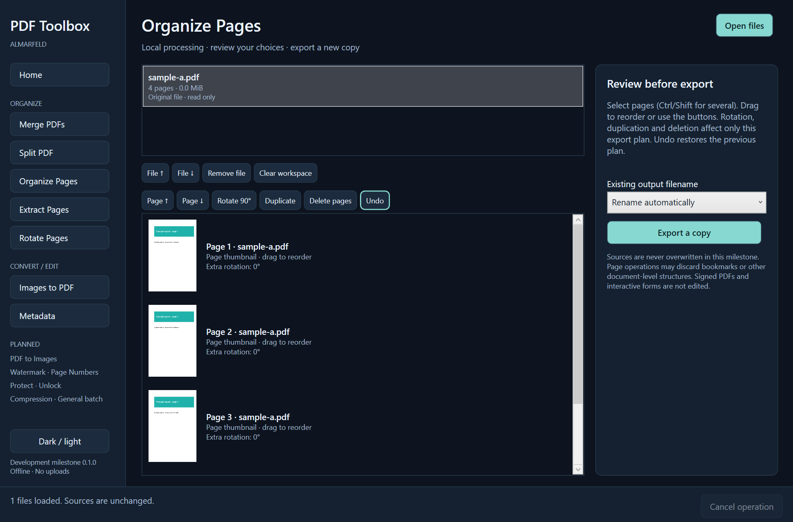

# PDF Toolbox

**PDF tools that stay on your device**

An independent ALMARFELD Windows desktop project. Open PDFs, review page choices and export a new copy, entirely on your computer. This is a desktop development build, not a published release.



## Working tools

| Tool | Current behavior |
| --- | --- |
| Merge | Combine all pages of ordered input PDFs. |
| Split | Ranges, every page, every N pages, or one PDF per selected page. |
| Organize Pages | Lazy thumbnails, drag/button reordering, rotation, deletion, duplication and session undo. |
| Extract Pages | Selected ranges into one PDF or separate copies. |
| Rotate | Selected ranges or all pages; existing rotation is retained. |
| Images to PDF | JPG/JPEG, PNG and BMP; A4/Letter, landscape, margins, Fit/Fill and JPEG quality. Source image preview. |
| Metadata | Inspect document information; edit Title, Author, Subject, Keywords and Creator in a copy. Producer is library-controlled. |
| PDF to Images | PNG/JPEG, all pages/ranges/highlighted pages, 36–600 DPI, JPEG quality, deterministic source-page filenames and per-page results. |
| Watermark | Text or PNG/JPEG image; opacity, rotation, nine positions, offsets and image scale. Selected-page preview uses the export drawing code. |
| Page Numbers | All pages or ranges, starting number, prefix/suffix, four formats, six positions, font size/margin and excluding initial source pages. |
| Protect PDF | Password-protect a new copy with verified PDF 1.6 AES-128 encryption. |
| Unlock PDF | Create an unencrypted copy with valid credentials; restricted documents require the owner password. |
| Compress PDF | Conservative lossless stream compression with actual original/output byte counts. No output is saved if it is not smaller. |

General batch processing remains explicitly disabled. WEBP is not supported.

Protect uses the same password for opening and owner access, with no artificial permission restrictions. Enter and confirm 1–32 printable ASCII characters; incompatible/longer passwords are rejected rather than silently truncated. The UI can show/hide the password. Unlock is password-based only: no cracking, bypass or cloud service. Unsupported security models fail without saving a final output. Encryption protects content confidentiality; it does not identify or authenticate the document author.

Compression has one implemented mode, not cosmetic presets. It compresses eligible unfiltered PDF streams with Flate and uses PDFsharp's content-stream compression. It does not rasterize pages, downsample images, recompress JPEGs or remove metadata/forms/annotations. Already-compressed/scanned PDFs may not shrink. Actual output is measured before finalization; an equal/larger trial is discarded. PDFsharp can update its Producer information during rewriting. Keep the original and inspect the copy; advanced document preservation is not universally guaranteed.

Watermark and numbering are added as PDF content; the whole document is not rasterized. Numbering follows selected pages in source order after exclusions. In `Page X of Y` / `X / Y`, Y is the last assigned number, including the starting offset. Overlays are positioned relative to the displayed crop box and rotation. Non-zero media-box origins/custom UserUnit, out-of-page placements and overlays too large to fit are refused rather than guessed. Windows font glyph coverage can limit unusual characters; inspect the preview and output.

## Requirements and first run

Windows 10 **version 2004 or later**, or Windows 11, x64. The self-contained development build includes the .NET 8 runtime. It does **not** require WebView2. Windows supplies the PDF preview and image-export renderer.

Extract the entire build folder and keep its adjacent files together. Run `PDFToolbox.exe`. There is no installer, automatic updater or automatic dependency download. The Windows binary is not Authenticode signed; Windows may show a reputation warning. Do not disable Windows security.

Use Open files / Ctrl+O, or drop supported files onto the window. Select a tool, review options and choose Export copy / Ctrl+S. Organize changes affect only the export plan. Recent files and passwords remain session-only; closing the application clears them.

## Safety and limits

- Originals are never overwritten, including when chosen as the output or through a detected hard-link alias. Replace is available only for a separate existing output after confirmation. Rename is the default collision policy.
- Output is staged beside the destination, reopened to validate PDF page count or decode exported images, and finalized atomically. Failed/cancelled stages are discarded. Split and PDF-to-images are per-output: completed files remain, and failed/skipped files are reported individually. Image replacement requires confirmation of the existing target list; new conflicts are refused.
- Password-protected PDFs can be inspected using a valid password and explicitly unlocked with valid owner credentials. Other editing, image export, compression and reprotection refuse encrypted inputs: unlock a copy first. Passwords are never saved or logged; controls are cleared after security export/cancel and when switching tools. An opened encrypted source retains its password in session memory while previews need it.
- Known signature dictionaries/fields are refused for rewriting. Page-editing tools refuse interactive forms; security and lossless compression preserve the existing document tree, with synthetic form/annotation regression coverage. This is not cryptographic signature verification.
- Page imports do not promise preservation of bookmarks, document-level links, attachments, tags, accessibility structure or other advanced PDF features. Keep the original and verify output in your PDF reader before relying on it.
- Metadata editing is **not sanitization**: XMP, content and attachments may retain information.
- Limits: 256 MiB and 5,000 pages per PDF; 100 PDF inputs and 512 MiB combined per operation; 10,000 output pages. Engine images limit: 500; UI workspace limit: 100 files. Images are limited to 256 MiB and 40 megapixels each. Large/malformed files may still exceed available memory or be unsupported.
- PDF-to-image export is sequential and capped at 40 megapixels / 16,000 pixels per side. Watermark images are capped at 16 megapixels. High DPI can still require several hundred MiB for a single page; reduce DPI when memory is constrained. Resolution and stored image DPI are independent of display scaling.
- Cancellation is checked between work units and before finalization; an individual library parse/render/save call may finish before cancellation takes effect.

## Offline and privacy

No accounts, uploads, ads, telemetry, analytics or network code. Files are processed locally. Preview rendering is independent of export DPI, capped at 1200×1600 pixels while preserving aspect ratio, and cached within 16 entries / 24 MiB of estimated decoded pixels. No preview files are persisted. Output temporary files are removed after failure/cancellation. See [privacy](docs/privacy.md) and [security](SECURITY.md).

## Build and tests

Install a .NET SDK supporting .NET 8 and Windows desktop/WinRT targeting (CI uses SDK 10 with the .NET 8 test runtime).

```powershell
dotnet restore PDFToolboxWindows.sln --locked-mode
dotnet build PDFToolboxWindows.sln -c Release --no-restore
dotnet test PDFToolboxWindows.sln -c Release --no-build
dotnet publish src/PDFToolbox.Windows -c Release --no-restore -o artifacts/windows/PDFToolbox
```

Do not publish development artifacts as a release without completing the release checks. The screenshot above is captured from the actual Windows application using synthetic input, with no cursor or personal paths. Architecture and validation details: [architecture](docs/architecture.md), [testing](docs/testing.md), [dependencies/licenses](docs/pdf-libraries.md).

MIT. [ALMARFELD](https://almarfeld.com/) · [Support](https://almarfeld.com/support/)
